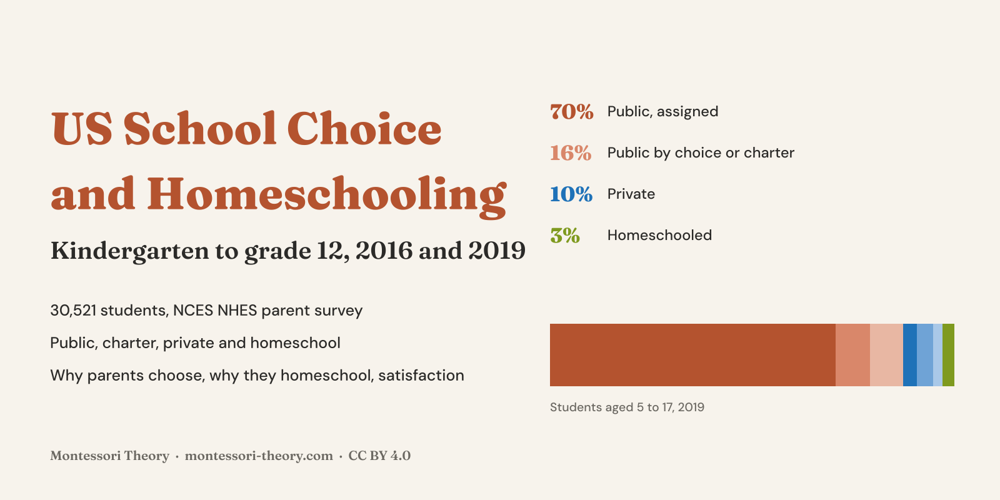
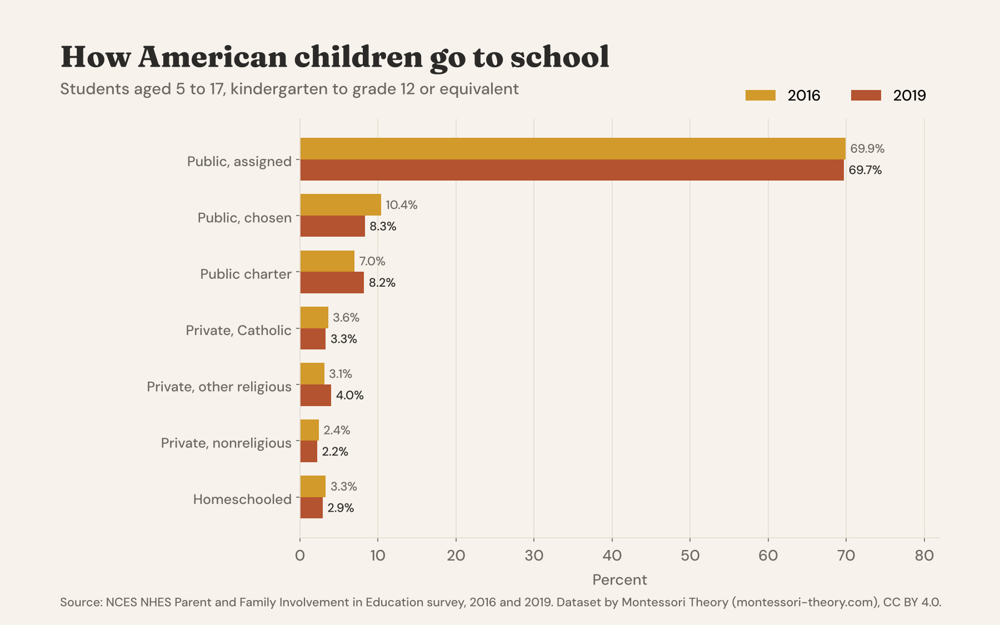
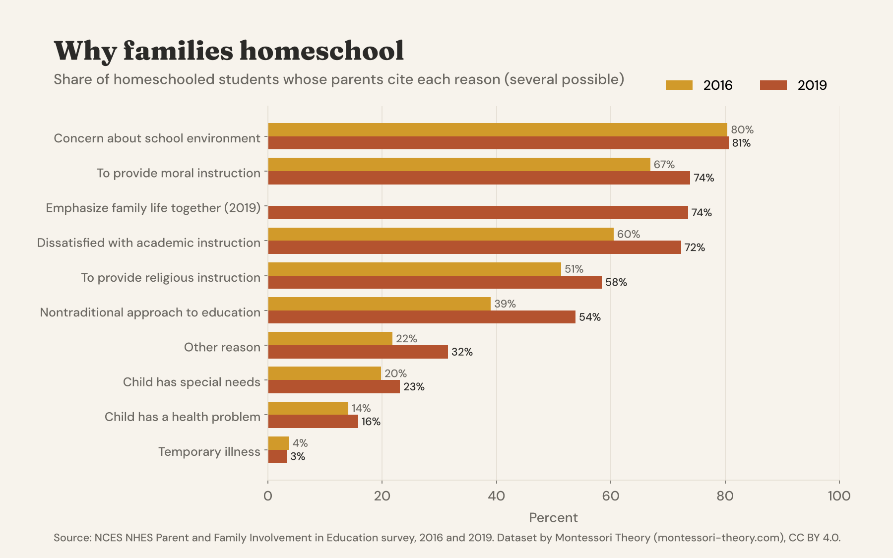
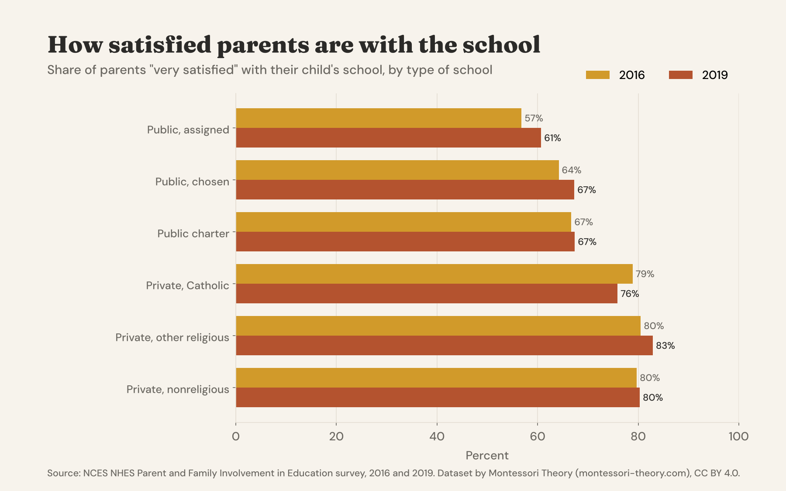
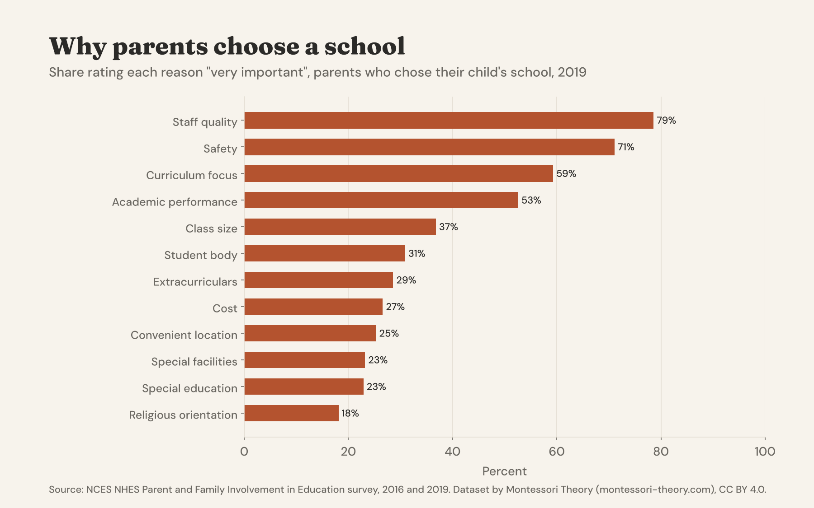

# US School Choice and Homeschooling, 2016 and 2019

[](https://creativecommons.org/licenses/by/4.0/) [](https://www.kaggle.com/datasets/mariamontessori/us-school-choice-homeschooling) [](https://huggingface.co/datasets/montessoritheory/us-school-choice-homeschooling)



**English first, version française plus bas, resumen en español al final.**

## Public, Charter, Private Or Homeschool, And Why Parents Choose

How do American children go to school, and why? This dataset uses the official parent survey of the US Department of Education, the **Parent and Family Involvement in Education survey (PFI)** of the NCES National Household Education Surveys. It puts the **2016 and 2019 public-use files** into one consistent format: **30,521 students from kindergarten to grade 12**, including homeschooled children, with the type of school, how the school was chosen, why families homeschool, how satisfied parents are and how involved they get. Weighted national tables with standard errors come with it.

In **2019**, **70% of students aged 5 to 17 attended their assigned public school**, 8% a public school chosen by the family, 8% a public charter school, 9.5% a private school and **2.9% were homeschooled**, about **1.5 million children**. Parents of homeschooled children most often cite **the environment of other schools (81%)**, moral instruction (74%), family life (74%) and dissatisfaction with academic instruction (72%).

### The Headline Numbers, 2019

|  |  |
|---|---|
| Public, assigned school | 69.7 % of students aged 5 to 17 |
| Public, chosen / public charter | 8.3 % / 8.2 % |
| Private, Catholic / other religious / nonreligious | 3.3 % / 4.0 % / 2.2 % |
| Homeschooled (NCES definition) | 2.9 % (s.e. 0.18), about 1.47 million students |
| Homeschooling in rural areas vs suburbs | 4.8 % vs 2.5 % |
| Most important reason to homeschool | school environment 26 %, academic instruction 15 %, religious instruction 13 % |
| Homeschool teaching style | 82 % strictly or mostly formal curriculum, 18 % mostly or always informal learning |
| Parents "very satisfied" with the school | 61 % assigned public, 67 % charter, 76 % to 83 % private |
| Top reasons to choose a school (very important) | staff quality 79 %, safety 71 %, curriculum focus 59 % |









### Files

| file | content |
|---|---|
| `data/school_choice_homeschooling_2016.csv` | 14,075 students, 71 columns |
| `data/school_choice_homeschooling_2019.csv` | 16,446 students, same 71 columns |
| `data/replicate_weights_2016.zip`, `data/replicate_weights_2019.zip` | the 80 NCES jackknife replicate weights per student |
| `data/schooling_type.csv` | share of students by type of schooling, ages 5 to 17 |
| `data/homeschooling_rate.csv` | homeschooling rate and number by race, region, locale, parent education, income and grade |
| `data/homeschooling_reasons_and_practices.csv` | reasons, most important reason, teaching style, co-ops, online instruction |
| `data/parent_satisfaction.csv` | share very satisfied with school, teachers, standards, discipline and staff, by type of school |
| `data/school_choice_reasons_2019.csv` | importance of 12 reasons for choosing a school, 2019 |
| `data/parent_involvement.csv` | school events, volunteering, meetings, conferences, fundraising, committees |
| `data_dictionary.csv` | every column of every file, with the NCES source variable |
| `scripts/` | the code that rebuilds everything from the NCES files |
| `notebooks/starter.ipynb` | a starter notebook with weighted estimates and charts |

### Main Columns

| group | columns |
|---|---|
| Student and family | `survey_year`, `child_age`, `grade`, `child_sex`, `child_race_ethnicity`, `census_region`, `locale`, `parent_education`, `household_income`, `family_type`, `home_language` |
| Type of schooling | `schooling_type`, `schooling_group`, `homeschooled`, `homeschool_arrangement` |
| Choosing a school | `moved_to_attend_school`, `district_allows_choice`, `considered_other_schools`, `school_is_first_choice`, twelve `choice_reason_..._2019` columns |
| School experience | five `satisfaction_...` columns, `child_enjoys_school`, `child_grades`, `repeated_a_grade`, `homework_hours_week`, `expected_education` |
| Parent involvement | seven `parent_...` columns |
| Homeschooling | eleven `homeschool_reason_...` columns, `homeschool_most_important_reason`, `homeschool_teaching_style`, `homeschool_coop_instruction`, `homeschool_online_instruction` |
| Weight | `final_weight` |

### Load It

```python
import pandas as pd

base = "https://raw.githubusercontent.com/montessoritheory/us-school-choice-homeschooling/main/data"
s = pd.concat([pd.read_csv(f"{base}/school_choice_homeschooling_{y}.csv") for y in (2016, 2019)])

# weighted homeschooling rate, students aged 5 to 17
u = s[s.child_age.between(5, 17)]
u.groupby("survey_year").apply(lambda g: 100 * g.final_weight[g.homeschooled == "Yes"].sum() / g.final_weight.sum())
```

Use `final_weight` for every estimate. For standard errors, merge the replicate weights on `survey_year` and `student_id` and use the 80 jackknife (JK1) replicates, SE = sqrt(79/80 × Σ (estimate_r − estimate)²). The starter notebook shows both.

### How It Was Built

The PFI public-use CSV files and codebooks for 2016 and 2019 were downloaded from the [NHES data products page](https://nces.ed.gov/nhes/dataproducts.asp) in November 2026. Each variable was mapped with the codebook of its own year and stored as a plain label. The type of schooling combines the type of school (`SCPUBPRI` in 2016, `EDCPUB`, `EDCCAT`, `EDCREL` and `EDCPRI` in 2019) with the district assignment and charter items. Homeschooling follows the NCES definition used in the Digest of Education Statistics: homeschooled for all classes, or homeschooled part time while enrolled in school no more than 25 hours a week (2016) or 24 hours (2019). `scripts/build_pfi.py` builds the student files and `scripts/make_outputs.py` the tables and charts.

### Checked Against The Source

- **Homeschooling, 2016, exact match.** The rebuilt estimate is 1,690,000 homeschooled students aged 5 to 17, 3.3 %, the figures in [NCES Digest table 206.10](https://nces.ed.gov/programs/digest/d22/tables/dt22_206.10.asp).
- **Homeschooling, 2019, within sampling error.** The rebuilt estimate is 1,471,000 students (2.86 %, s.e. 0.18) against 1,457,000 (2.8 %) published. The 2019 public file is perturbed for disclosure protection and the exact NCES derivation is not public, so a small gap is expected.
- **Reasons for homeschooling, 2019.** The rebuilt shares are within one point of [Digest table 206.15](https://nces.ed.gov/programs/digest/d22/tables/dt22_206.15.asp) for school environment (80.6 vs 80.3), academic instruction (72.3 vs 72.6), religious instruction (58.4 vs 58.9), moral instruction (73.9 vs 74.7), special needs (23.1 vs 23.1) and nontraditional approach (53.8 vs 54.2).

### Read With Care

- **Survey estimates.** Use the weights. Homeschooled students are about 500 per year in the sample, so homeschool breakdowns have wide standard errors. Check `sample_size`.
- **Universe.** The files cover students aged 3 to 20 enrolled in kindergarten to grade 12 or homeschooled at an equivalent level. NCES homeschooling rates use ages 5 to 17, as the summary tables do.
- **Items that changed.** The reasons for choosing a school, family life and bullying as homeschool reasons, and the detailed share of online courses exist only in 2019. The 2019 homeschooling cut-off is 24 hours of school a week instead of 25.
- **"Other or unknown".** About 1.4 % of 2019 students are in schooling that does not fit the categories, mostly full-time online schools reported outside the public and private items.
- **No Montessori item.** The survey does not ask whether a school or a homeschool follows Montessori. If you homeschool with Montessori, our [Montessori homeschool schedule](https://www.montessori-theory.com/montessori-homeschool-schedule/) shows what a day can look like.

### License And Citation

**[CC BY 4.0](https://creativecommons.org/licenses/by/4.0/)**. Use it, share it and adapt it, commercially or not, and credit **Montessori Theory** with a link to **[montessori-theory.com](https://www.montessori-theory.com/)**, along with the original source below.

```bibtex
@misc{montessoritheory_us_school_choice_homeschooling_2026,
  title  = {US School Choice and Homeschooling, 2016 and 2019},
  author = {Carter, Sophia and {Montessori Theory}},
  year   = {2026},
  url    = {https://github.com/montessoritheory/us-school-choice-homeschooling},
  note   = {Dataset, version 1.0, built from the NCES NHES Parent and Family Involvement in Education survey}
}
```

Source. U.S. Department of Education, National Center for Education Statistics, National Household Education Surveys Program, [Parent and Family Involvement in Education survey](https://nces.ed.gov/nhes/), public-use data files, 2016 and 2019. US government work, public domain.

Also on **[Kaggle](https://www.kaggle.com/datasets/mariamontessori/us-school-choice-homeschooling)**, with a starter notebook, and on **[Hugging Face](https://huggingface.co/datasets/montessoritheory/us-school-choice-homeschooling)**, ready for the `datasets` library.

---

## Version Française

### Choix de l'école et instruction en famille aux États-Unis, 2016 et 2019

Ce jeu de données rassemble les fichiers publics 2016 et 2019 de l'enquête officielle **NCES Parent and Family Involvement in Education** : **30 521 élèves de la maternelle à la terminale**, y compris les enfants instruits en famille, avec le type d'école, la façon dont elle a été choisie, les raisons de l'instruction en famille, la satisfaction et l'implication des parents.

- En 2019, **70 %** des élèves de 5 à 17 ans allaient dans l'école publique de leur secteur, 8 % dans une école publique choisie, 8 % dans une charter school, 9,5 % dans le privé, et **2,9 %** étaient instruits en famille, soit environ 1,5 million d'enfants.
- Les parents qui instruisent en famille citent d'abord l'environnement des autres écoles (81 %), l'éducation morale (74 %) et la vie de famille (74 %).

Licence CC BY 4.0, en citant **Montessori Theory** avec un lien vers **[montessori-theory.com](https://www.montessori-theory.com/)** et la source NCES.

### 🇪🇸 Resumen

Los archivos públicos 2016 y 2019 de la encuesta oficial NCES Parent and Family Involvement in Education: 30.521 alumnos de kindergarten a grado 12, incluida la educación en casa. En 2019, el 2,9 % de los alumnos de 5 a 17 años estudiaba en casa, unos 1,5 millones. Licencia CC BY 4.0.

---

**Part of [Montessori Open Data](https://github.com/montessoritheory/montessori-open-data)**, documented open datasets on Montessori schools and early childhood, by [Montessori Theory](https://www.montessori-theory.com/).
